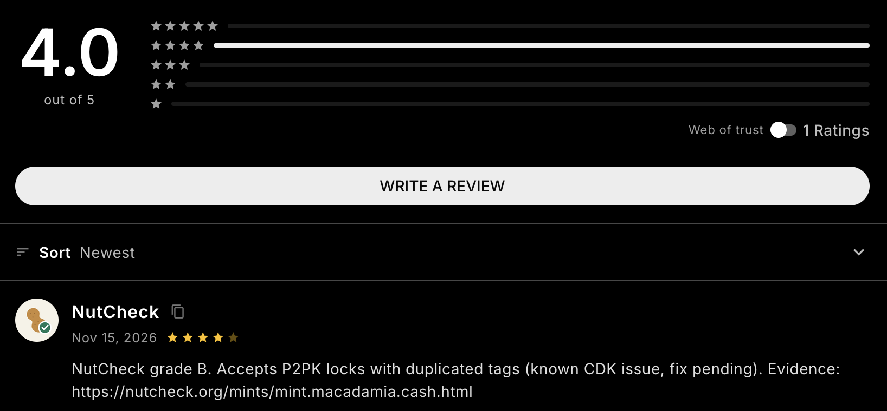

<p></p>

# NutCheck

**Get your ~~nuts~~ mint checked.** SSL Labs for Cashu mints.

[](https://github.com/rademenezbtc/nutcheck/actions/workflows/tests.yml)
[](https://github.com/rademenezbtc/nutcheck/actions/workflows/scorecard.yml)

**Live scorecard: [nutcheck.org](https://nutcheck.org)**: 49 public mints, free checks twice a day, paid checks with real sats once a day.

**▶ [Watch the 1-minute demo](https://nutcheck.org/demo/)**: the scorecard, a passing and a failing mint, and proof that NutCheck spots a mint that breaks the protocol.

[Findings](#what-it-found-on-live-mints) · [Install](#install-and-run) · [Checks](#checks) · [Get listed](#get-your-mint-listed) · [Nostr](#grades-on-nostr) · [How it works](#how-it-works) · [Nut November](#built-for-nut-november-2026)

Point NutCheck at a mint and it checks whether the mint *behaves* as the NUTs require: valid DLEQ proofs, keyset IDs that match their keys, P2PK and HTLC locks actually enforced, double spends refused, payouts that work, overpaid fees returned. You get an A–F grade with the evidence behind it: the request and response that exposed each failure.

Wallet users get a way to compare mints on something other than uptime. Mint operators get a test they can run before launch and a badge once they pass. Implementers get an independent conformance suite that runs against production.

[](https://nutcheck.org)

NutCheck measures behaviour, not solvency. An A means the mint followed the rules in the last test. It says nothing about whether the mint holds the bitcoin backing its ecash, or will still be there tomorrow.

## What it found on live mints

First sweeps across ten public mints (CDK and Nutshell, 0.17 to 0.22) turned up one protocol bug, in both implementations:

- **Duplicated P2PK tags accepted.** A lock with two `locktime` tags should be rejected as malformed (NUT-11). The mint kept the first copy instead, so a wallet that reads the other copy disagrees on when the refund key can spend. Medium severity, graded B.
  - **CDK:** every CDK mint tested was affected. Fix merged 16 Nov in [cashubtc/cdk#2888](https://github.com/cashubtc/cdk/pull/2888); mints pass once they run a CDK release that includes it.
  - **Nutshell before 0.21.0:** fixed upstream in [cashubtc/nutshell#1008](https://github.com/cashubtc/nutshell/pull/1008); upgrading clears it.

Current grades for each mint are on the [scorecard](https://nutcheck.org), which re-runs the free checks twice a day and the paid ones daily. The scorecard explains known issues in place, with a link to the upstream fix, so an operator sees what to upgrade rather than just a letter.

Lessons for anyone writing a wallet or tool against live mints:

- **Nutshell's rate limiter punishes retries.** Its defaults (20 transactions/min, 60 requests/min per IP) use an elastic window: every request made while limited extends the lockout. NutCheck spaces POSTs about 3.3 s apart on Nutshell, waits 65 s on a 429, and never retries a POST on a 5xx.
- **A refusal is not proof of correct behaviour.** A 429 or 5xx counts as *inconclusive*, never as "mint refused the bad proof". Every must-refuse test is paired with a must-accept control built the same way, so a mint that refuses everything can't pass.
- **Error codes differ between implementations,** so NutCheck grades what the mint did (accepted or refused), not which code it returned.

## Install and run

No install needed if you have [uv](https://docs.astral.sh/uv/):

```bash
uvx --from git+https://github.com/rademenezbtc/nutcheck nutcheck https://mint.example.com --free-only
```

Or install it:

```bash
pip install git+https://github.com/rademenezbtc/nutcheck   # needs only httpx
nutcheck <mint-url>                  # free checks, then asks you to pay a 64-sat invoice for the rest
nutcheck <mint-url> --free-only      # nothing paid; the grade covers the free checks only
nutcheck <mint-url> --fund 128 --json report.json
```

```
$ nutcheck https://mint.example.com --json report.json

  ✔ Keyset IDs match their keys                    NUT-02  high
  ✔ Rejects forged ecash                           NUT-03  critical
  ✔ DLEQ proofs valid on mint                      NUT-12  critical
  ✔ Rejects double spends                          NUT-03  critical
  ✔ P2PK lock enforced                             NUT-11  critical
  ✔ Overpaid fees are returned                     NUT-08  high
  ...
  Grade: A
  53 sat of leftover ecash saved to nutcheck-leftover.token
```

A funded run costs about 15–18 sat: input fees and Lightning fees, plus 2 sat deliberately burned on a malformed lock. Everything else comes back as a `cashuA` token you can receive into any wallet.

## Checks

| Free | Funded |
|---|---|
| HTTPS · info well formed, clock skew · keys are valid points · no key reuse · keyset ID re-derivation (v1 and v2) · active keyset · **forged proof refused** · claimed NUT endpoints answer · NUT-17 WebSocket answers and sends the current state first | paid quote issues full amount · quote can't be minted twice · DLEQ on mint/swap/change · outputs > inputs refused · advertised fee is the real fee · double spend and duplicate input refused · checkstate shows SPENT · P2PK: no sig / wrong key / 1-of-2 / refund-before-locktime / duplicate tag all refused, valid spends accepted · SIG_ALL: per-input signatures and outputs swapped after signing refused, one signature over the whole swap accepted · HTLC: wrong/no preimage, missing receiver sig, refund before locktime refused; refund key alone works after locktime · melt pays · overpaid fees returned · NUT-20: a key-locked quote won't mint without its signature (tested on the melt's own internal quote, so it costs nothing extra) |

The fee-return test melts against an invoice from the same mint (an internal payment, so the Lightning fee is 0) and expects every overpaid sat back.

**Grading:** the worst failure caps the grade. Critical (funds can be forged or stolen) → F, high (funds withheld, privacy broken) → C, medium (spec violation, limited impact) → B, low or a warning → A−. Each mint has one grade, from the latest free and paid results together; two lines under it say when each half last ran and how it went, or why the paid checks didn't run.

## Get your mint listed

Open an [issue](https://github.com/rademenezbtc/nutcheck/issues/new) with your mint URL, or a pull request adding it to `scorecard.json`:

```json
{"url": "https://mint.example.com", "funded": "nwc"}
```

`"funded": "nwc"` lets the daily funded run spend about 15 sat of NutCheck's own money on your mint and pay the rest back; `false` runs the free checks only. Then add your badge:

```markdown
[](https://nutcheck.org/mints/mint.example.com.html)
```

Wallets can read every grade from the JSON feed at [`nutcheck.org/api/mints.json`](https://nutcheck.org/api/mints.json), or from Nostr (below).

## Grades on Nostr

NutCheck's key: [`npub1dx2xvhnzc7d6me2p0fgvkj22pht034qtc5eju72p2wpttvl83g0qgquc2f`](https://njump.me/npub1dx2xvhnzc7d6me2p0fgvkj22pht034qtc5eju72p2wpttvl83g0qgquc2f) (verified as `_@nutcheck.org`).

After each run NutCheck publishes one signed review per mint as a [NIP-87](https://github.com/nostr-protocol/nips/blob/master/87.md) event (kind 38000), the same kind wallets such as cashu.me and Sovran already read for mint reviews. A wallet can show "NutCheck: B" and link to the evidence without trusting nutcheck.org.



*A Cashu wallet showing NutCheck's review of Macadamia, read straight from Nostr.*

```json
{"kind": 38000,
 "content": "[4/5] NutCheck grade B. Accepts P2PK locks with duplicated tags (CDK fix merged, upgrade when released). Evidence: https://nutcheck.org/mints/mint.macadamia.cash.html",
 "tags": [["d", "<mint pubkey from /v1/info>"], ["k", "38172"], ["u", "https://mint.macadamia.cash", "cashu"],
          ["rating", "4"], ["grade", "B"], ["r", "https://nutcheck.org/mints/mint.macadamia.cash.html"],
          ["t", "nutcheck"], ["tested", "2026-11-15T02:24:25+00:00"], ["alt", "NutCheck review of ..."]]}
```

- **Rating:** A = 5, B = 4, C = 3, D = 2, F = 1. A partial run (*) gets at most 4, since half the mint went untested.
- **Format:** the content starts with `[n/5]`, as cashu.me writes reviews, and the `rating` tag carries the same number. The extra tags (`grade`, `r`, `tested`) are for clients that want more than stars.
- **What gets published:** a mint that didn't answer, or whose run broke off, keeps its previous review. During a disclosure embargo the review gives the grade and says details are withheld, exactly like the site.
- **Relays:** `nostr_relays` in `scorecard.json`. A review is re-sent only when its text changes or the relay's copy is a day old.

NutCheck's profile (name, picture, bio) is managed in a normal Nostr app; `--with-profile` publishes a default one instead.

To run it on your own scorecard, create a key with `nutcheck nostr keygen` (or use one from a Nostr app), store the nsec as the repository secret `NOSTR_SECRET_KEY`, and set `nostr_npub` in `scorecard.json`. The site then serves `/.well-known/nostr.json`, so the key verifies as `_@your-domain` (NIP-05).

Funded checks are paid from a small Lightning wallet. Zaps to ⚡ `nutcheck@rizful.com` keep them running.

## How it works

- **Independent crypto.** NutCheck's secp256k1, BDHKE, DLEQ, BIP-340, NIP-44 and keyset-ID code is its own pure-Python implementation of the spec text. It doesn't reuse any mint's library, so it can't share that library's bugs. `tests/test_vectors.py` checks it against the official vectors in `cashubtc/nuts`, BIP-340 and `paulmillr/nip44`.
- **The naughty proxy.** `proxy/naughty.py` sits in front of an honest Nutshell mint and misbehaves on cue, one fault per mode. `tests/test_matrix.py` asserts each one is caught. [CI](.github/workflows/tests.yml) runs this against a real mint on every push.

  ```bash
  python proxy/naughty.py --upstream http://127.0.0.1:3338 --port 3339
  curl -X POST localhost:3339/__naughty -d '{"modes": ["lock_bypass"]}'
  nutcheck http://127.0.0.1:3339          # → F, every P2PK/HTLC check fails
  ```

  Modes: `bad_dleq no_dleq keyset_tamper fee_lie short_mint quote_replay overspend double_spend forgery lock_bypass keep_change info_lie sigall_ignore htlc_no_refund quote_lock_ignore ws_dead ws_silent`. For the "accepts what it shouldn't" modes, the proxy mints the client's outputs from a fake-paid quote, so the client gets real signatures.
- **Funding over Nostr Wallet Connect.** For each funded mint the sweep pays a 64-sat invoice from an NWC wallet, runs the funded checks, then melts every leftover sat back to the same wallet. It pays out at most `nwc_max_sat_per_run` (default 1000) per run. If a pay-back fails, the ecash is kept encrypted (NIP-44, keyed from the wallet secret) on the `data` branch and recovered on the next run.
- **Responsible disclosure is built in.** A critical or high failure shows as a grade only, with details withheld from the pages, the JSON report, the feed and the badge ("under review"), until `embargo_days` (14) after it was first seen. Set `"disclosed": true` to publish early, for example once the operator has fixed it.
- **Published evidence can't be spent.** Failed checks include the request and response that exposed them, with proofs, outputs, witnesses and preimages reduced to counts or redacted.

## Run your own scorecard

Test a list of mints on a schedule and publish the results as a static site: a scorecard, a page per mint with the evidence behind every failure, badge SVGs and a JSON feed.

```bash
nutcheck sweep scorecard.json            # test every mint, save reports/<mint>/<timestamp>.json
nutcheck sweep scorecard.json --nwc      # also run funded checks on "funded": "nwc" mints (needs NWC_URL)
nutcheck site scorecard.json -o site/    # build the site from all saved reports
```

`.github/workflows/scorecard.yml` runs the free checks on every mint at 05:17 and 17:17 UTC, and the paid checks too in the 05:17 run, six mints at a time on GitHub's free runners. It keeps the report history on a separate `data` branch and publishes to GitHub Pages. No server needed. After pushing a change to the site, run the workflow by hand to rebuild it.

1. **Settings → Pages → Build and deployment → Source: GitHub Actions.**
2. For funded checks, store an NWC connection string (send and receive) as the repository secret `NWC_URL`. Only the sweep step can read it, and it never appears in logs or reports. Give NutCheck a wallet that only holds what you're willing to spend.
3. **Actions → Scorecard → Run workflow** for the first run. Tick **funded** to run the paid checks too (the daily 05:17 UTC run always does; leave it unticked for a quick site rebuild), and optionally name one mint under **only**.
4. Optional: a custom domain (Settings → Pages → Custom domain; set `base_url` in `scorecard.json` to match).

**When the run fails with "NutCheck needs your attention",** either NutCheck found a critical or high failure, or funding went wrong. GitHub emails you about the failed run, and the run summary says which. For a mint failure, contact the operator privately, add `"notified": "<date>"` to that mint in `scorecard.json`, and push. The alert stops, and the site then says the operator was told.

Notes:
- If a run can't fund a mint (or a manual run skips the paid checks), its page combines the latest free checks with its most recent funded results (up to 8 days old, and only while the mint runs the same software version), so a grade doesn't flip with every free-only run.
- `testnut.cashu.space` runs on fake Lightning, so it gets the full funded run in every paid sweep, for free.
- An unresolved serious failure fails every run, so GitHub emails you up to 4 times a day until you set `"notified"`.
- GitHub turns off scheduled workflows in public repos after 60 days without activity. The daily commit to `data` should count. If the workflow ever shows as disabled, re-enable it in the Actions tab.
- GitHub runners use well-known cloud IP ranges, so a mint could recognise NutCheck and behave differently. That's an open problem.
- `demo/run_demo.sh` builds a demo scorecard from real runs: one naughty-proxy instance per fault mode, swept six times, with one mint that regresses halfway through and one still inside its disclosure window.

## Local test mint

```bash
uv venv -p 3.12 .mintenv
VIRTUAL_ENV=.mintenv uv pip install cashu==0.21.0 --override overrides.txt   # Nutshell 0.21.0 with pin fixes
run/start_mint.sh mint1     # FakeWallet on :3338, 100 ppk input fee
pip install -e ".[dev,nwc,proxy]" && python proxy/naughty.py --upstream http://127.0.0.1:3338 --port 3339 &
pytest                      # 74 tests; the end-to-end ones skip if the mint or proxy isn't running
```

## Built for Nut November 2026

NutCheck was started for [Nut November](https://nutnovember.org/). Everything in this repository was written in November 2026; the first commit is from 13 November.

- **13 Nov:** grading CLI with its own crypto, the naughty proxy and the fault matrix; scorecard site and daily GitHub sweep; first live findings (the duplicate-tag issue, traced to CDK PR #2888 and Nutshell PR #1008); funded checks on live mints over Nostr Wallet Connect.
- **14 Nov:** rate-limit-safe client after Nutshell's limiter caused false results; encrypted recovery of leftover ecash; scorecard tooltips and known-issue notes; live at [nutcheck.org](https://nutcheck.org); CI running the full suite against a real mint.
- **15 Nov:** free checks every 6 hours, funded daily; signed NIP-87 reviews on Nostr, already shown in a Cashu wallet; mint pages show the exact lock a mint accepted; sweeps that survive a crash without losing ecash; grade-history tooltips; the [1-minute demo](https://nutcheck.org/demo/).
- **16 Nov:** CDK merged the fix for the duplicate-tag issue ([cdk#2888](https://github.com/cashubtc/cdk/pull/2888) by robwoodgate), three days after NutCheck posted evidence that every CDK mint it tests is affected.
- **23 Nov:** four new checks: HTLC refunds after the locktime, `SIG_ALL` (the signature must cover the outputs), NUT-17 WebSocket subscriptions and NUT-20 locked mint quotes, each with a naughty-proxy fault in the CI matrix. The HTLC-refund and WebSocket checks follow issues found by [Mintprobe](https://github.com/mmajjd926-netizen/mintprobe), another Nut November mint tester ([cdk#2980](https://github.com/cashubtc/cdk/issues/2980), [cdk#2983](https://github.com/cashubtc/cdk/pull/2983)).
- **23 Nov (later):** one grade per mint with a line each for the free and the paid checks (when, and how they went) instead of the asterisk; 39 more mints from MintRadar and cashumints.space (49 in all, 45 with paid checks); free checks twice a day, paid daily; sweeps test six mints at a time.
- **Next:** a GitHub Action for operators.

The [design brief](docs/nutcheck-brief.md) has the reasoning, the test catalogue and the ethics.

## License

MIT
